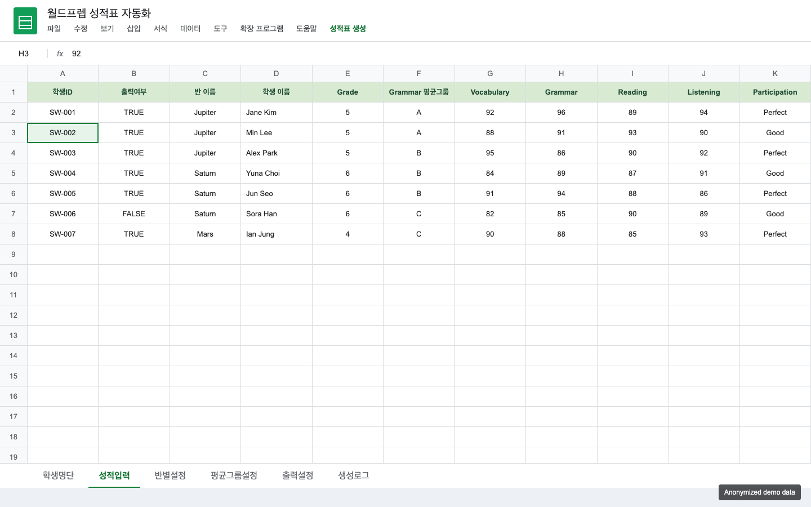
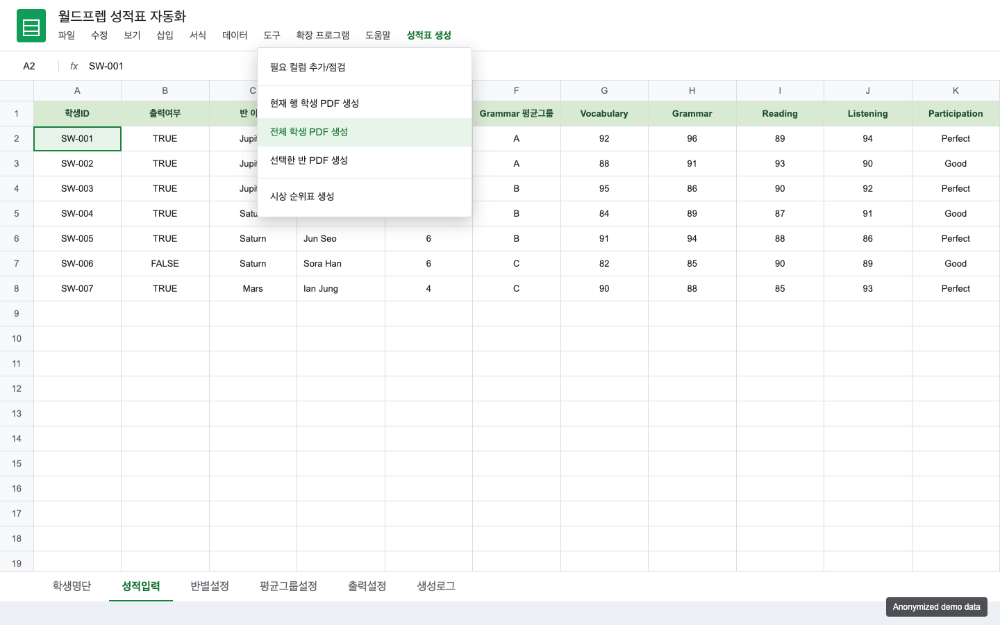
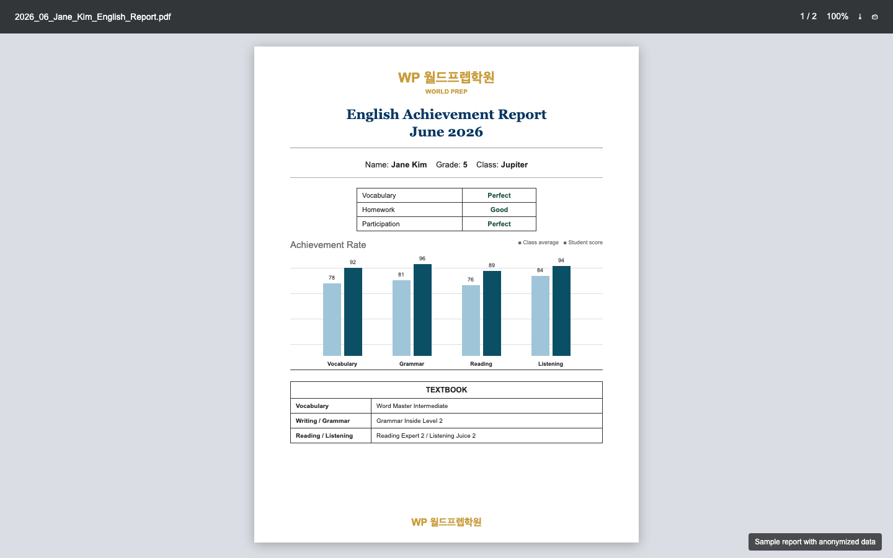
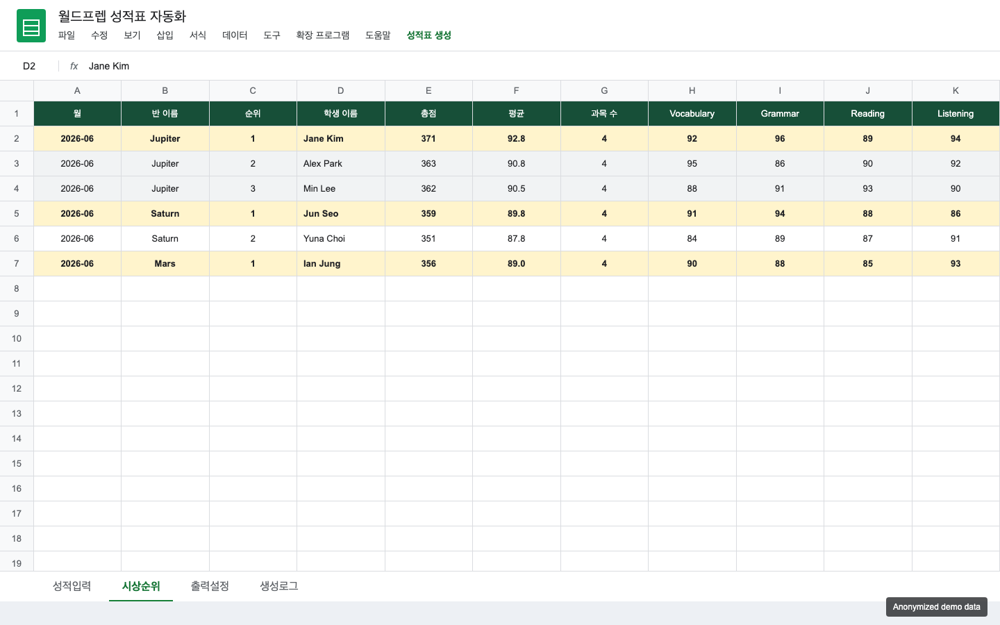
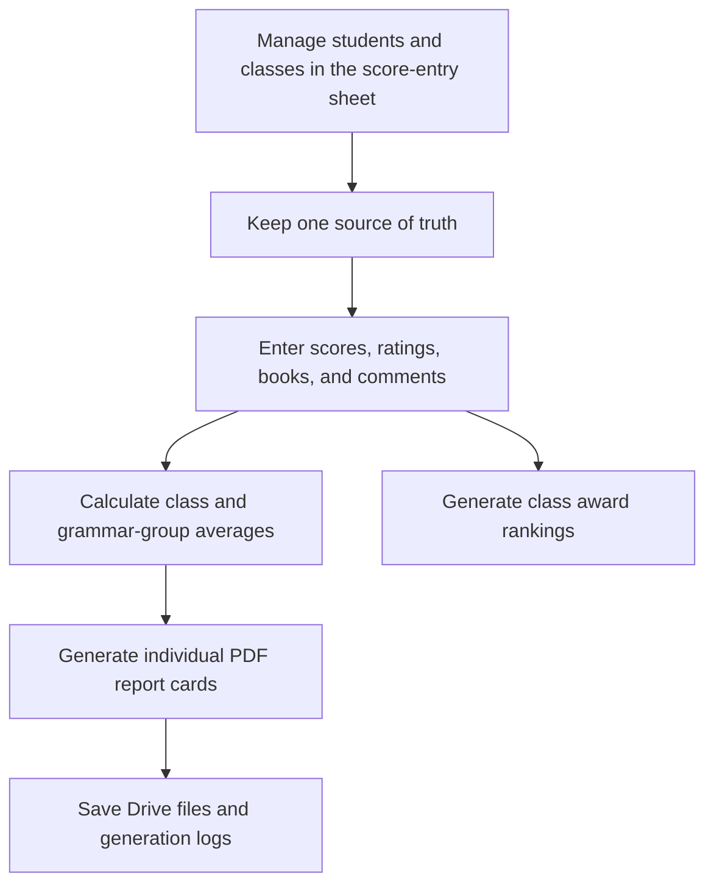

# English Academy Report-Card Automation

> A workplace automation project that reduced a report-card cycle for more than 200 elementary students from over two weeks of manual work to roughly one working day.

Built with Google Sheets, Google Apps Script, HTML/CSS, Google Drive PDF export, and the OpenAI Responses API.

## At a Glance

| Score-entry workflow | Report-generation menu |
|:---:|:---:|
|  |  |
| **Generated report card** | **Automated award ranking** |
|  |  |

_All screenshots contain anonymized demonstration data. No real student information is included in this repository._

## Why I Built It

I began working as an assistant English instructor at an elementary English academy during the summer break of my third year at university. I was hired to support lessons, not to develop software. Soon after joining, however, I saw the staff preparing a major reporting cycle for more than 200 students.

The existing process was almost entirely manual. Staff entered student information and scores across multiple subjects, calculated comparison averages, wrote subject comments, assembled report cards, and prepared award rankings. The work had a fixed parent-delivery deadline and had to be completed alongside daily teaching.

I proposed keeping the Google Sheets interface that staff already knew and using Apps Script as the automation layer. The goal was not just to produce one batch of PDFs, but to leave behind a system that the academy could continue to operate without a developer.

## Final Operating Model



The final version:

- uses `성적입력` as the single source for student identity and assessment data;
- gives each student a hidden, persistent ID;
- moves the complete physical row when a student changes class;
- preserves scores, ratings, books, grammar groups, comments, notes, formulas, formatting, and validation during that move;
- keeps one blank separator row between class groups;
- freezes the four identity columns while assessment columns scroll horizontally;
- provides explicit student add/delete and class add/rename/delete commands;
- removes the redundant `출력여부` checkbox and uses active student rows for batch output;
- calculates regular class averages and separate grammar-group averages;
- generates two-subject or four-subject PDF report cards;
- creates class award rankings with tie handling;
- optionally polishes teacher comments with the OpenAI Responses API; and
- records generated file names, statuses, and Google Drive links.

## Main Workflow

1. Staff maintain active classes and textbook defaults in `반별설정`.
2. Staff add students and manage class placement directly in `성적입력`.
3. Entering or changing a class moves the intact row to the end of that class block.
4. Staff enter scores, ratings, grammar groups, textbooks, and comments in the same row.
5. A departing student is permanently removed only through an explicit delete action or `퇴원` status change.
6. Teachers generate PDFs, polish comments, and create award rankings from the custom menu.
7. The system saves PDFs to Google Drive and writes the result to `생성로그`.

## Development Journey

The final structure was not the first implementation. It emerged through repeated feedback, data-safety failures, and regression fixes in a live spreadsheet workflow.

### 1. Automating the Manual Report Cycle

The first version focused on the visible bottleneck: turn entered scores and comments into consistent PDF reports. I built the HTML/CSS report template, average calculations, Drive export, file naming, and generation logs around the academy's existing spreadsheet.

After report generation worked, I added class award rankings because that was the next task staff performed after completing scores. This shifted the project from a single script toward an operational workflow.

### 2. Replacing Row Position with Stable Identity

Spreadsheet row numbers are not reliable identities. Rows move when classes are reorganized or separator rows are inserted, so position-based updates can attach completed work to the wrong student.

I introduced hidden persistent student IDs and treated the student, not the row number, as the identity boundary. Legacy data is connected only when the match is unambiguous.

### 3. Stopping Destructive Synchronization

An early two-sheet design automatically synchronized a student roster with the score sheet. In real use, roster replacement, partial edits, and class changes caused entered scores or comments to disappear.

The first repair was a guarded, non-destructive import model. It could update identity fields but refused to clear assessment data or guess ambiguous same-name matches. This solved the immediate data-loss path and established a core rule: uncertain automation must stop rather than guess.

### 4. Separating Data Movement from Spreadsheet UI Setup

Another iteration rebuilt validation rules during synchronization. The values survived, but Google Sheets also reset carefully assigned dropdown colors. The underlying problem was that one routine was responsible for both data movement and interface configuration.

I separated those responsibilities, removed installable synchronization triggers, and made dropdown and sheet-format setup an explicit maintenance operation.

### 5. Moving to One Operational Sheet

The safe importer reduced risk, but staff still had to understand which sheet owned each field and when synchronization should run. Feedback consistently pointed to a simpler expectation: add or edit the student directly where scores are entered.

I removed the separate roster dependency from normal operation and made `성적입력` the only source of truth. New and existing students now follow the same rule: changing the class moves the complete row to that class's final position. No assessment field is reconstructed from a partial object.

Student and class lifecycle operations also became explicit. A class cannot be deleted while students still reference it, and a student is deleted as a complete row only through a deliberate action.

### 6. Encoding the Academy's Class Order

Alphabetical sorting did not match the curriculum. For example, it could place `PowerStation` before `Pre-Inter`. I encoded a normalized domain order that handles differences in spaces, hyphens, and capitalization:

```text
Starter 1-4
Beginner 1-4
Pre-Inter 1-4
Advanced 1-4
PowerStation 1-2
Grammar 1-4
```

The class settings list and row-placement logic use the same normalized identity and ordering rules.

The detailed problem-solving record is available in [PORTFOLIO_CASE_STUDY.md](PORTFOLIO_CASE_STUDY.md).

## Core Features

### Report-Card PDF Generation

Each generated report includes:

- academy branding and student information;
- learning-attitude ratings;
- a chart comparing the student score with the relevant average;
- textbook information; and
- subject-specific teacher comments on a second page.

### Average Calculation

- Writing, Reading, and Listening/Speaking use class-based averages.
- Grammar can use a separate `Grammar 평균그룹`, such as `A`, `B`, or `C`.
- Blank score subjects are excluded from averages, charts, and report sections.

### Award Ranking

The generated `시상순위` sheet includes month, class, rank, student, total, average, subject count, and subject scores. Students are grouped by class, sorted by total score, and ties receive the same rank.

### Admin-Friendly Settings

- `반별설정`: class list and class-level textbook defaults
- `출력설정`: report title, output month, Drive folder, file-name rule, and AI model

## My Role and Ownership

I identified the operational problem, proposed the project, translated staff workflows into rules, designed the spreadsheet behavior, tested real scenarios, diagnosed regressions, and prepared the handoff documentation.

This project was created early in my programming journey, and I used AI extensively to help draft and revise code. My responsibility was to define constraints, inspect behavior, reproduce failures, protect live teacher-entered data, and decide whether each change was safe enough to deploy. I present the project as end-to-end product and engineering ownership, not as a claim that every line was written without assistance.

## Outcome

The previous report-card cycle took more than two weeks of manual effort. The completed workflow made it possible to handle the core process within approximately one working day. This is an operational before-and-after estimate from the workplace, not a controlled benchmark.

The stronger outcome was adoption. Staff continued using the system, provided feedback that shaped later iterations, and asked about future automation work. The project demonstrated that a lightweight tool can create durable value when it fits the users' existing environment and treats their data as the primary constraint.

## What I Learned

- Useful automation begins with understanding people and workflow, not choosing a technology.
- A shared spreadsheet is a small information system and needs identity and integrity safeguards.
- Successful output is not enough; changes require regression testing across the full workflow.
- AI can accelerate implementation, but it does not replace requirements, verification, or responsibility.
- The safest automation makes destructive actions explicit and predictable.

## Technology

- Google Apps Script and Google Sheets
- HTML/CSS templates
- Google Drive PDF export
- Spreadsheet edit handling and document locking
- OpenAI Responses API for optional comment polishing
- Script Properties for secret storage

## Repository Guide

- [`Code.gs`](Code.gs): student and class management, safeguards, averages, PDF generation, AI comment polishing, and ranking logic
- [`ReportTemplate.html`](ReportTemplate.html): two-page report-card template
- [`PORTFOLIO_CASE_STUDY.md`](PORTFOLIO_CASE_STUDY.md): detailed engineering iterations and decisions
- [`업데이트_이용방법.md`](업데이트_이용방법.md): Korean-language operating and handoff guide
- [`appsscript.json`](appsscript.json): runtime, timezone, and OAuth configuration

## Privacy and Responsible Use

The public repository contains code, templates, and anonymized demonstrations only. Real names, scores, teacher comments, generated PDFs, API keys, and private Google Sheet contents are excluded. AI-based comment polishing is optional, and secrets are stored in Script Properties rather than source code.
