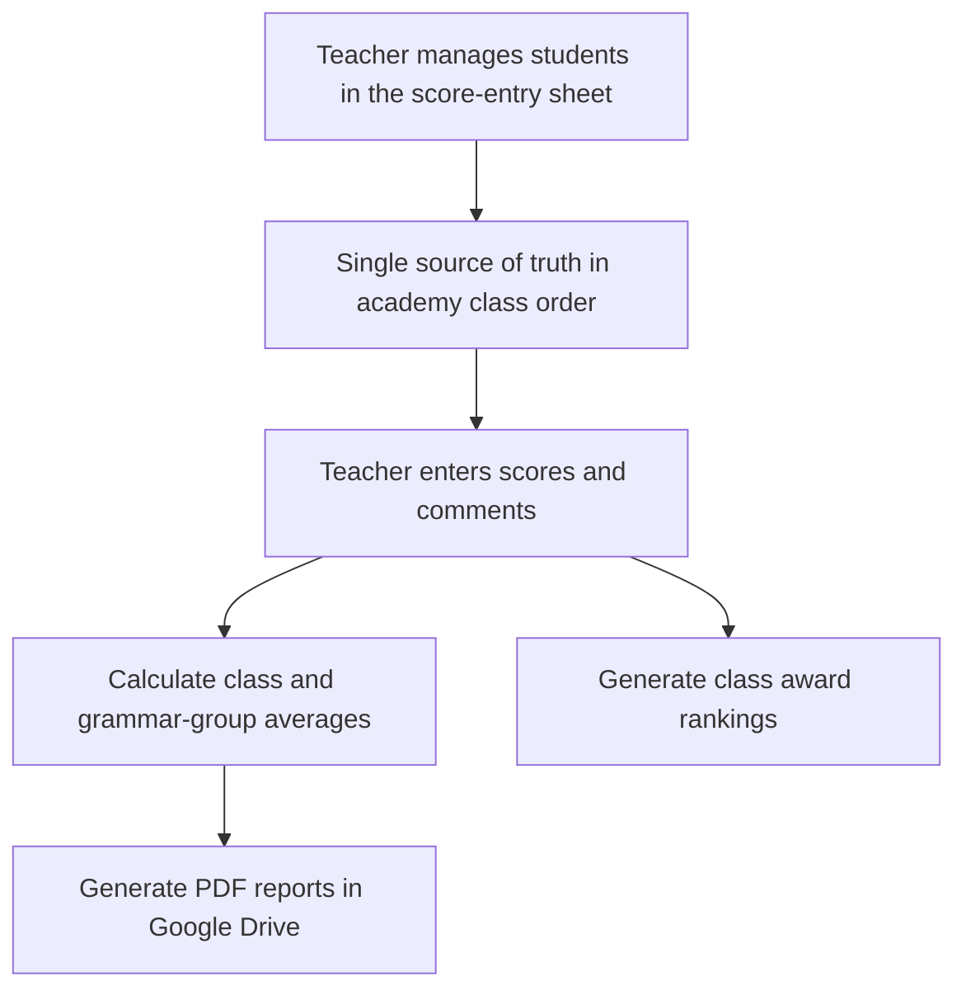

# English Academy Report Automation

A Google Apps Script system that turns an academy's existing Google Sheets workflow into a safer report-card pipeline, from roster management and score entry to PDF generation and award rankings.

## System at a Glance

| Score Input Sheet | Report Generation Menu |
|:---:|:---:|
|  |  |
| **Generated PDF Report Card** | **Automated Award Ranking Sheet** |
|  |  |

_All screens use anonymized demonstration data. No real student information is shown._

## Automation Workflow



## Project Background

I joined an elementary English academy as an assistant English instructor during my university break. The academy was preparing student report cards, comments, average comparisons, and award rankings manually.

Even in a part-time role, I try to look beyond the task immediately in front of me and understand the wider workflow. I ask questions such as:

- Why is this work performed this way?
- How much time is being spent on repetitive tasks?
- As staff fatigue accumulates, how do errors and service quality change?
- How might those changes affect parent satisfaction, student re-enrollment, and academy revenue?
- How much time and cost could be saved by introducing the right technology?

From this perspective, manual report-card preparation was more than an inconvenient routine. I believed that repeated administrative work could increase teacher fatigue and the likelihood of mistakes, eventually affecting the quality of service delivered to parents and students.

Rather than replacing tools the staff already knew, I kept the academy's existing Google Sheets environment and automated report generation, average calculations, and award rankings with Google Apps Script. This lightweight approach reduced repetitive work without requiring a separate application or paid system.

This project was built to help teachers generate report cards faster, reduce manual calculation work, and make student award rankings immediately available after entering scores.

## What This System Does

- Uses `성적입력` as the single source for student information and assessment data
- Uses stable student IDs so data follows the student rather than a visual row position
- Moves an intact student row when a name or class is edited, preserving scores and comments
- Keeps exactly one blank separator row between different class groups
- Adds, renames, and deletes classes through explicit menu commands
- Permanently deletes a student only through an explicit action or `퇴원` status change
- Removes the redundant per-row output checkbox and generates batch reports for active students
- Generates individual PDF report cards from Google Sheets data
- Supports 2-subject and 4-subject report formats automatically
- Compares each student's score with the relevant class or grammar-group average
- Separates grammar average groups from regular class averages
- Creates a second-page teacher comment table by subject
- Uses dropdowns for repeated inputs such as class names, grammar groups, and learning attitude ratings
- Allows report title, output month, folder name, and file naming rules to be changed from a settings sheet
- Creates a class-by-class award ranking sheet sorted by total score
- Logs generated PDF results and Drive links
- Validates score ranges and required report fields before creating each PDF

## Main Workflow

1. Staff maintain active classes and textbook defaults in `반별설정`.
2. Staff manage students and class placement directly in `성적입력`.
3. Staff add students from the menu; completed rows move to the end of the selected class as intact rows.
4. Changing an existing student's class moves the full row, preserving scores, ratings, books, and comments.
5. Departing students are permanently removed after an explicit menu confirmation or by selecting `퇴원`.
6. Teachers generate PDFs, polish comments, and create award rankings from the menu.
7. The system saves reports to Google Drive and records results in `생성로그`.

## Key Features

### Report Card PDF Generation

The PDF template is built with Apps Script HTML templates. Each report includes:

- Academy logo
- Student name, grade, and class
- Learning attitude table
- Achievement chart comparing student score and average score
- Textbook information
- Subject-specific teacher comments on page 2

### Average Comparison Logic

The system calculates averages by configurable groups:

- Reading, Writing, and Listening/Speaking use class-based averages
- Grammar can use a separate `Grammar 평균그룹`, such as `A`, `B`, or `C`

This reflects the academy's real teaching structure, where grammar classes may not always match the main class name.

### Award Ranking Automation

The `시상순위` sheet is generated automatically from entered scores. It shows:

- Month
- Class name
- Rank
- Student name
- Total score
- Average score
- Number of subjects entered
- Scores by subject

Students are grouped by class and sorted from highest to lowest total score. Ties receive the same rank.

### Admin-Friendly Settings

Teachers can update operational data without editing code:

- `반별설정`: active class list and class-related defaults
- `출력설정`: report title, output month, folder name, and file name rule

### Single-Sheet Roster Management and Data Safety

The final workflow removes the separate roster dependency. Staff manage identity, class placement, and assessment data in `성적입력`, so there is no automatic two-sheet synchronization that can rewrite teacher work.

- New student rows receive a hidden stable ID and active enrollment status.
- Once a name and class are entered, the complete row moves to the end of that class block.
- Editing an existing class moves the same physical row, so scores, ratings, books, grammar groups, and comments move together.
- Different classes remain separated by one blank row for scanning and repeated data entry.
- Selecting `퇴원` or using the delete command removes the complete row; menu deletion requires confirmation.
- Batch PDF generation and award rankings use active rows directly, without a separate `출력여부` checkbox.
- A document lock prevents overlapping row-management operations.

### Operational Class Ordering

The class settings screen uses the academy's normalized curriculum order:

```text
Starter 1-4
Beginner 1-4
Pre-Inter 1-4
Advanced 1-4
PowerStation 1-2
Grammar 1-4
```

Spaces, hyphens, and capitalization are normalized for comparison. Staff add, rename, or delete classes through the custom menu. A class cannot be deleted while student rows still reference it.

## Technology

- Google Apps Script
- Google Sheets
- HTML/CSS for PDF templates
- Google Drive PDF export
- OpenAI Responses API for optional teacher-comment polishing
- Script Properties for API-key storage
- Simple spreadsheet edit handling and Apps Script locking

## Files

- `Code.gs`: student and class management, data safeguards, menus, PDF generation, averages, AI comments, and ranking logic
- `ReportTemplate.html`: HTML/CSS template for the PDF report card
- `PORTFOLIO_CASE_STUDY.md`: detailed problem-solving and iteration record
- `업데이트_이용방법.md`: operational setup guide for applying updates in Apps Script
- `appsscript.json`: V8 runtime, timezone, and required OAuth scopes

## Engineering Journey

### 1. Replacing Row-Position Assumptions with Stable Identity

An early cleanup routine revealed that spreadsheet row positions are not reliable identities. Rows move whenever classes are sorted or separator rows are inserted, so a position-based update could associate assessment data with the wrong student.

I redesigned the model around hidden, persistent student IDs. Legacy rows are connected only when an ID or unique student name makes the association safe. This changed the synchronization contract from "same row" to "same student."

### 2. Replacing Destructive Synchronization with a Safer Intermediate Model

Real use showed that even a guarded delete path was too risky for a score workbook. I first introduced a non-destructive import path that updated identity fields while refusing to clear assessment data. This stopped the immediate data-loss failure and established a stronger rule: uncertain automation must stop rather than guess.

### 3. Fixing a Dropdown-Color Regression

An intermediate version refreshed data-validation rules during every sync. In Google Sheets, that also rebuilt the dropdown presentation and turned carefully assigned class colors white. I traced the problem to synchronization doing two unrelated jobs: moving data and rebuilding UI rules.

The intermediate repair isolated roster import from validation-rule setup. Old installable change triggers were removed, and normal student edits moved toward `성적입력`. Dropdown setup and sheet formatting became explicit maintenance operations.

### 4. Creating a Deterministic Academy Class Order

Alphabetical sorting placed `PowerStation` before `Pre-Inter` and did not match the academy's teaching progression. I introduced an explicit domain order and a normalization function that handles variants such as `Pre-Inter 1`, `Pre-Inter1`, and differences in capitalization. Class settings and row-placement logic use this order while moving complete rows so teacher-entered fields stay attached.

### 5. Simplifying the Final Workflow Around One Sheet

The safer import reduced data loss, but staff feedback showed that maintaining a separate roster and understanding synchronization rules still created operational risk. Teachers wanted to add a student, change a class, and continue entering scores in one place.

I removed the roster dependency and redesigned normal operations around `성적입력`:

- adding a student creates a prepared row with a stable hidden ID
- completing the name and class moves the intact row to that class's final position
- editing an existing class moves the full row rather than rebuilding its values
- class blocks keep one blank separator row
- class creation, rename, and deletion are explicit menu operations
- student removal is explicit and removes the complete row
- batch output uses active student rows directly, so `출력여부` is no longer needed

This final iteration was not a clean-slate rewrite. It was the result of observing real failures, preserving already-entered teacher work, and repeatedly narrowing automation to behavior staff could predict.

The detailed iteration record is available in [PORTFOLIO_CASE_STUDY.md](PORTFOLIO_CASE_STUDY.md).

## Impact

This project converted a manual report-card workflow into a repeatable automation process. It helped teachers:

- Reduce repetitive data entry and calculation work
- Maintain one roster source without manually copying changes into the score sheet
- Generate report cards more quickly
- Avoid manual average and ranking mistakes
- Produce consistent PDF designs
- Protect existing teacher input during roster changes and class reordering
- Prepare award rankings immediately after entering scores

The project is a practical example of applying AI-era tooling and automation thinking to a real workplace problem, even outside a formal software engineering role.

## User Feedback and Workplace Recognition

After introducing the system, I conducted short feedback check-ins with the academy director and teachers. I asked whether the tool was easy to use, which features were most helpful, whether it reduced the inconvenience of the previous workflow, what additional features they needed, and whether they intended to keep using it.

The feedback was consistently positive. The staff recognized that the system reduced repetitive work and made the report-card process easier to manage, while the conversations also gave me practical direction for future improvements.

The response went beyond positive comments about the tool. Less than one month after I started working at the academy, I was asked whether I would consider moving beyond the part-time role and joining as a regular staff member. I was also asked whether I would be willing to take on future outsourced automation work for the academy. For me, this was meaningful evidence that proactively identifying an operational problem and delivering a usable solution could build trust quickly, even without holding a formal software position.

## Privacy Note

This repository contains the automation code and template only. Real student data, generated PDFs, and private Google Sheet contents should not be committed.
