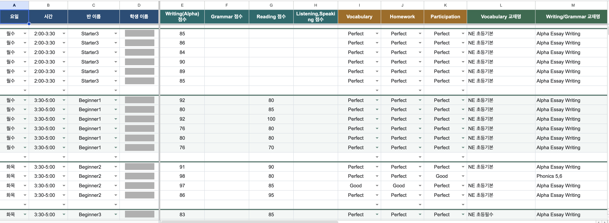
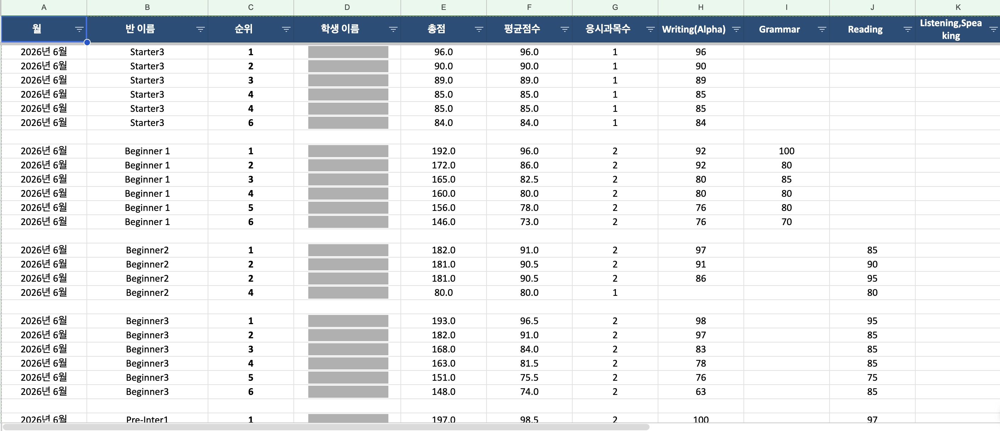
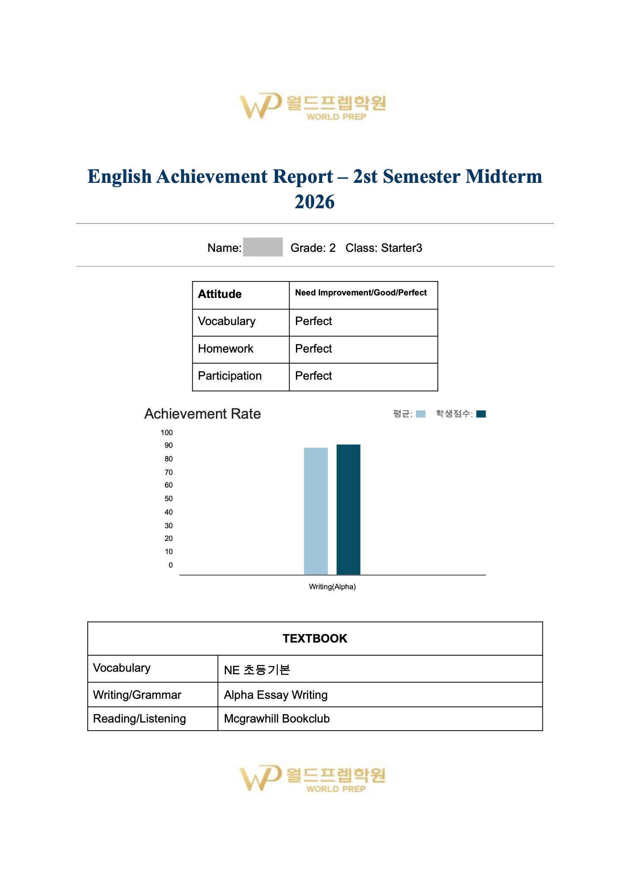
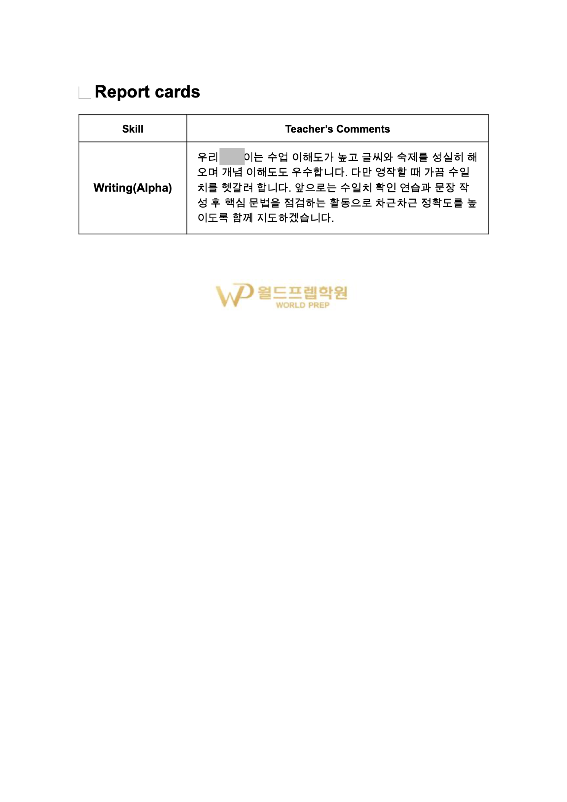
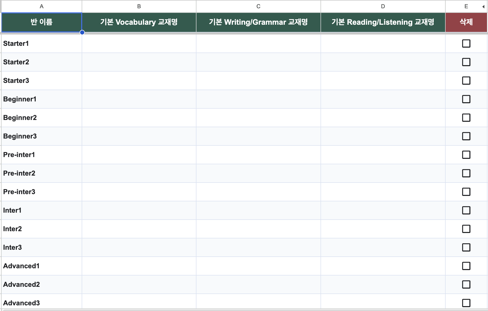
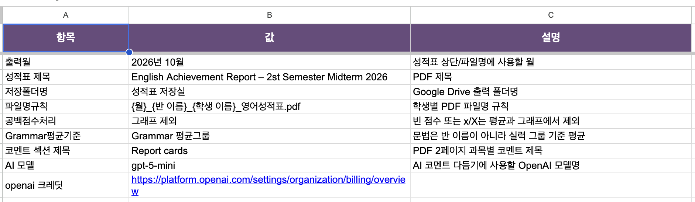
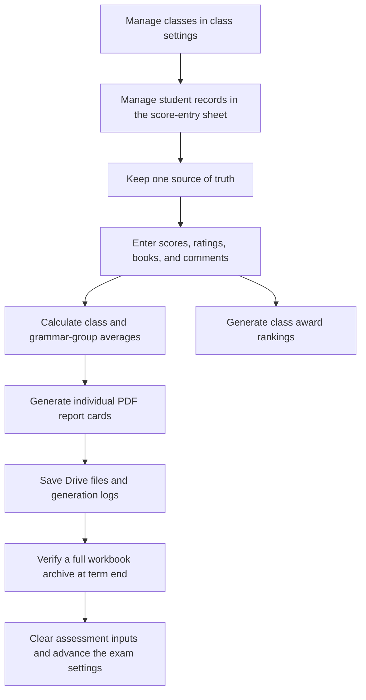

# English Academy Report-Card Automation

> A workplace automation project that reduced a report-card cycle for approximately 80 elementary students from over two weeks of manual work to roughly one working day.

Built with Google Sheets, Google Apps Script, HTML/CSS, Google Drive PDF export, and the OpenAI Responses API.

**Current release:** November 2026. The original commit history and [development case study](PORTFOLIO_CASE_STUDY.md) trace the project from its first report generator through the current operating model.

This repository presents the project's development decisions, real name-redacted results, and regression evidence as a portfolio case study.

## Actual Application Captures

| Score-entry sheet | Class award ranking |
|:---:|:---:|
|  |  |
| **Generated report: assessment page** | **Generated report: teacher comments** |
|  |  |
| **Class settings** | **Output settings** |
|  |  |

These are user-supplied screenshots and rasterized pages of an actual generated report, not reconstructed interfaces. Student names are covered with opaque masks, including names inside comments. Other displayed values and original labels are retained as supplied; captures may reflect different reporting dates or workbook revisions. See the [image provenance note](docs/images/README.md). The original unredacted screenshots and PDF are not published.

## Why I Built It

I began working as an assistant English instructor at an elementary English academy during the summer break of my third year at university. I was hired to support lessons, not to develop software. Soon after joining, however, I saw the staff preparing a major reporting cycle for approximately 80 students.

The existing process was almost entirely manual. Staff entered student information and scores across multiple subjects, calculated comparison averages, wrote subject comments, assembled report cards, and prepared award rankings. The work had a fixed parent-delivery deadline and had to be completed alongside daily teaching.

I proposed keeping the Google Sheets interface that staff already knew and using Apps Script as the automation layer. The goal was not just to produce one batch of PDFs, but to leave behind a system that the academy could continue to operate without a developer.

## Final Operating Model



The final version:

- uses `성적입력` as the single source for student identity and assessment data;
- gives each student a hidden, persistent ID;
- moves the complete physical row when a student changes class;
- preserves scores, ratings, books, grammar groups, comments, notes, formulas, formatting, and validation during that move;
- keeps one blank separator row between class groups;
- freezes the four identity columns while assessment columns scroll horizontally;
- provides a dropdown-based student form and confirmed student deletion, with class management in `반별설정`;
- starts with 18 editable classes in the Starter, Beginner, Pre-inter, Inter, Advanced, and Powerstation sequence;
- removes the redundant `출력여부` checkbox and uses active student rows for batch output;
- calculates regular class averages and separate grammar-group averages;
- renders the entered score subjects and omits empty optional PDF sections;
- creates class award rankings with tie handling;
- optionally polishes teacher comments with the OpenAI Responses API, preserving originals and a retry position;
- records generated file names, statuses, and Google Drive links; and
- archives and verifies the workbook before clearing quarterly scores and comments and advancing the report title and month.

There is no active roster-to-score synchronization. Some compatibility helpers remain in `Code.gs`, but the roster synchronization entry point is disabled and the old spreadsheet-change handler is a no-op. Opening the workbook only creates the menu.

## Development Journey

The final structure was not the first implementation. It emerged through repeated feedback, data-safety failures, and regression fixes in a live spreadsheet workflow.

### 1. Automating the Manual Report Cycle

The first version focused on the visible bottleneck: turn entered scores and comments into consistent PDF reports. I built the HTML/CSS report template, average calculations, Drive export, file naming, and generation logs around the academy's existing spreadsheet.

After report generation worked, I added class award rankings because that was the next task staff performed after completing scores. This shifted the project from a single script toward an operational workflow.

### 2. Replacing Row Position with Stable Identity

Spreadsheet row numbers are not reliable identities. Rows move when classes are reorganized or separator rows are inserted, so position-based updates can attach completed work to the wrong student.

I introduced hidden persistent student IDs and treated the student, not the row number, as the identity boundary. Legacy data is connected only when the match is unambiguous.

### 3. Stopping Destructive Synchronization

An early two-sheet design automatically synchronized a student roster with the score sheet. In real use, roster replacement, partial edits, and class changes caused entered scores or comments to disappear.

The first repair was a guarded, non-destructive import model. It could update identity fields but refused to clear assessment data or guess ambiguous same-name matches. This solved the immediate data-loss path and established a core rule: uncertain automation must stop rather than guess.

### 4. Separating Data Movement from Spreadsheet UI Setup

Another iteration rebuilt validation rules during synchronization. The values survived, but Google Sheets also reset carefully assigned dropdown colors. The underlying problem was that one routine was responsible for both data movement and interface configuration.

I separated those responsibilities and moved away from installable synchronization triggers. In the current release, the legacy handlers are inactive rather than relying on privileged trigger deletion; ordinary score and comment edits do not initiate roster synchronization.

### 5. Moving to One Operational Sheet

The safe importer reduced risk, but staff still had to understand which sheet owned each field and when synchronization should run. Feedback consistently pointed to a simpler expectation: add or edit the student directly where scores are entered.

I removed the separate roster dependency from normal operation and made `성적입력` the only source of truth. New and existing students now follow the same rule: changing the class moves the complete row to that class's final position. No assessment field is reconstructed from a partial object.

Student and class lifecycle operations also became explicit. A class cannot be deleted while students still reference it, and a student is deleted as a complete row only through a deliberate action.

### 6. Encoding the Academy's Class Order

Alphabetical sorting did not match the curriculum. For example, it could place `PowerStation` before `Pre-Inter`. I encoded a normalized domain order that handles differences in spaces, hyphens, and capitalization:

```text
Starter -> Beginner -> Pre-inter -> Inter -> Advanced -> Powerstation
```

Initial setup creates levels 1-3 in each of these six groups. Later class additions are allowed. The comparator also recognizes several legacy levels; unknown class names follow the known curriculum sequence.

### 7. Making Comment Processing Recoverable

Teachers reported that some Listening/Speaking comments remained unchanged and that API failures could interrupt a batch. I added header-alias handling, retries, and a saved row-and-subject cursor. A failed nonempty comment remains the next item to retry instead of being silently skipped. Original text is retained in cell notes, and blank AI output is rejected.

The established Korean comment instructions and the `우리 이름이는/는` opening remain in place. Before saving a response, the program rechecks student identity and the original comment so a delayed API response does not overwrite a newer edit or another student's row.

### 8. Designing the Next Reporting Cycle

Once daily work was usable, the next requirement was reuse across the academic year. I added a quarter-end workflow that resolves an archive folder by name, copies the complete workbook, opens and verifies that copy, and only then clears the designated score and comment columns. Failure handling attempts a limited rollback and blocks a second reset when recovery is unresolved.

The next exam is calculated from the configured output month: April, June, October, December, then April of the following year. Only the report title and output month advance; student records, class settings, ratings, books, and the PDF destination remain in place.

### 9. Turning Reported Failures into Regression Tests

I added a dependency-free Node.js suite covering student creation, intact-row movement, class renames and deletion, AI retries and concurrent edits, report preparation, and archive/reset failure paths. The current release passes 78 local tests. Google services are mocked; this does not substitute for testing permissions, PDF layout, API responses, and recovery on a disposable Google Sheets copy.

The detailed problem-solving record is available in [PORTFOLIO_CASE_STUDY.md](PORTFOLIO_CASE_STUDY.md).

## Core Features

### Report-Card PDF Generation

Each generated report includes:

- academy branding and student information;
- learning-attitude ratings;
- a chart comparing the student score with the relevant average;
- textbook information; and
- subject-specific teacher comments on a second page.

### Average Calculation

- Writing, Reading, and Listening/Speaking use class-based averages.
- Grammar can use a separate `Grammar 평균그룹`, such as `A`, `B`, or `C`.
- Blank or `X` score subjects are excluded from averages and charts; numeric zero remains a valid score.
- Empty ratings, textbook rows, and comment sections are omitted rather than printed as empty placeholders.

### Award Ranking

The generated `시상순위` sheet includes month, class, rank, student, total, average, subject count, and subject scores. Students are grouped by class, sorted by total score, and ties receive the same rank.

### Admin-Friendly Settings

- `반별설정`: class list and class-level textbook defaults
- `출력설정`: report title, output month, Drive folder, file-name rule, and AI model

## My Role and Ownership

I identified the operational problem, proposed the project, translated staff workflows into rules, designed the spreadsheet behavior, tested real scenarios, diagnosed regressions, and prepared the handoff documentation.

This project was created early in my programming journey, and I used AI extensively to help draft and revise code. My responsibility was to define constraints, inspect behavior, reproduce failures, protect live teacher-entered data, and decide whether each change was safe enough to deploy. I present the project as end-to-end product and engineering ownership, not as a claim that every line was written without assistance.

## Outcome

The previous report-card cycle took more than two weeks of manual effort. The completed workflow made it possible to handle the core process within approximately one working day. This is an operational before-and-after estimate from the workplace, not a controlled benchmark.

The stronger outcome was adoption. Staff continued using the system, provided feedback that shaped later iterations, and asked about future automation work. The project demonstrated that a lightweight tool can create durable value when it fits the users' existing environment and treats their data as the primary constraint.

## What I Learned

- Useful automation begins with understanding people and workflow, not choosing a technology.
- A shared spreadsheet is a small information system and needs identity and integrity safeguards.
- Successful output is not enough; changes require regression testing across the full workflow.
- AI can accelerate implementation, but it does not replace requirements, verification, or responsibility.
- The safest automation makes destructive actions explicit and predictable.

## Technology

- Google Apps Script and Google Sheets
- HTML/CSS templates
- Google Drive PDF export
- Spreadsheet edit handling and document locking
- OpenAI Responses API for optional comment polishing
- Script Properties for secret storage
- Node.js built-in test runner for regression tests

## Verification and Limits

Run the local suite with Node.js 22 or newer:

```sh
node --test tests/new-student.test.cjs tests/quarter-reset.test.cjs tests/workflows.test.cjs
```

No dependency installation is required. [Test documentation](tests/README.md) distinguishes simulated services from live behavior and lists the release checks still required in Google Sheets.

Document locks coordinate cooperating script operations, not a teacher's direct typing. Pause all editing and API/PDF jobs during quarter-end reset. Student deletion is permanent, and reset intentionally clears formulas and notes inside the designated assessment columns after backup verification. Administrative role enforcement and sheet-protection rules are deployment responsibilities, not features automatically installed by this release.

## Repository Guide

- [`Code.gs`](Code.gs): student and class management, safeguards, averages, PDF generation, AI comment polishing, and ranking logic
- [`ReportTemplate.html`](ReportTemplate.html): two-page report-card template
- [`StudentForm.html`](StudentForm.html): new-student dialog with live class choices
- [`PORTFOLIO_CASE_STUDY.md`](PORTFOLIO_CASE_STUDY.md): detailed engineering iterations and decisions
- [`appsscript.json`](appsscript.json): runtime, timezone, and OAuth configuration
- [`tests/`](tests/): synthetic-data regression suite and service harness

## Privacy and Responsible Use

The public repository contains code, templates, synthetic test fixtures, and actual application captures with student names redacted. The captures retain the displayed assessment figures and class labels; name redaction is not a guarantee against all possible re-identification. Raw rosters, editable production workbooks, unredacted images, original PDF files, API keys, workbook backups, and the temporary one-time roster migration script are not included. Older illustration files are separately labeled as mockups in the [image provenance note](docs/images/README.md) and are not used in the gallery. AI-based comment polishing is optional, and secrets are stored in Script Properties rather than source code. Enabling it sends student names and selected teacher comments to the API; obtain the academy's approval and follow its student-data policy before use.
